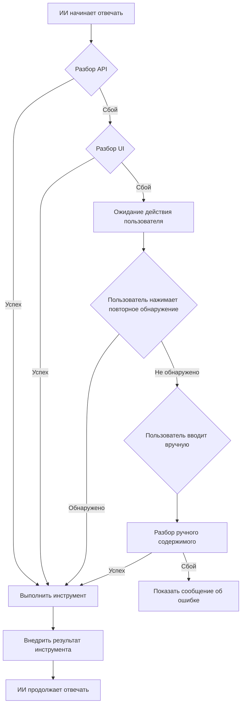

# Подробное описание четырёхуровневого механизма защиты

## Содержание

- [Обзор](#обзор)
- [Почему нужен четырёхуровневый механизм защиты](#почему-нужен-четырёхуровневый-механизм-защиты)
- [Первый уровень: разбор API](#первый-уровень-разбор-api)
- [Второй уровень: разбор UI DOM](#второй-уровень-разбор-ui-dom)
- [Третий уровень: повторное обнаружение](#третий-уровень-повторное-обнаружение)
- [Четвёртый уровень: ручной ввод](#четвёртый-уровень-ручной-ввод)
- [Процесс переключения механизмов](#процесс-переключения-механизмов)
- [Руководство по конфигурации](#руководство-по-конфигурации)
- [Лучшие практики](#лучшие-практики)

---

## Обзор

MCP Bridge использует **четырёхуровневый механизм защиты**, который гарантирует успешный запуск вызова инструментов в любых ситуациях с вероятностью, близкой к 100%.

### Обзор четырёх уровней

```
┌─────────────────────────────────────────────────────┐
│  Первый уровень: разбор API (основной способ)         │
│  • Перехват сетевых ответов, разбор потоковых данных  │
│    в реальном времени                                 │
│  • Успешность: 60–80% (зависит от платформы)          │
│  • Преимущество: самый быстрый, без задержек          │
│  • Недостаток: при разборе SSE возможна потеря        │
│    символов                                           │
└─────────────────────────────────────────────────────┘
                      ↓ при сбое
┌─────────────────────────────────────────────────────┐
│  Второй уровень: разбор UI DOM (автоматический резерв)│
│  • Извлечение ответа ИИ из DOM страницы               │
│  • Успешность: 90–99%                                 │
│  • Преимущество: стабильность, независимость от сети  │
│  • Недостаток: требуется дождаться завершения         │
│    рендеринга DOM                                     │
└─────────────────────────────────────────────────────┘
                      ↓ при сбое или обновлении страницы
┌─────────────────────────────────────────────────────┐
│  Третий уровень: повторное обнаружение                │
│  (возобновление с контрольной точки)                  │
│  • Запускается пользователем вручную, повторный       │
│    разбор из последнего сообщения                     │
│  • Успешность: близка к 100%                          │
│  • Преимущество: можно восстановить завершённый диалог│
│  • Недостаток: требуется ручное нажатие пользователя  │
└─────────────────────────────────────────────────────┘
                      ↓ при сбое
┌─────────────────────────────────────────────────────┐
│  Четвёртый уровень: ручной ввод (окончательный резерв)│
│  • Пользователь копирует и вставляет ответ ИИ,        │
│    вручную запускает разбор                           │
│  • Успешность: 100%                                   │
│  • Преимущество: абсолютная надёжность                │
│  • Недостаток: требуется действие пользователя        │
└─────────────────────────────────────────────────────┘
```

---

## Почему нужен четырёхуровневый механизм защиты

### Предпосылки проблемы

Разные ИИ-платформы сильно различаются по технической реализации:

| Платформа | Тип ответа | Формат данных | Сложность разбора API |
|-----------|------------|---------------|------------------------|
| DeepSeek | SSE | Пользовательский формат, правила фильтрации | ⭐⭐⭐ |
| Tongyi Qianwen | SSE | Стандартный формат, несколько путей | ⭐⭐ |
| Tencent Yuanbao | SSE | Инъекция в два поля | ⭐⭐⭐ |
| Doubao | SSE | Поле JSON-строки | ⭐⭐⭐⭐ |
| ChatGPT | SSE | Сложная вложенность | ⭐⭐⭐⭐⭐ |

### Ключевые вызовы

**Нестабильность потоковых SSE-ответов**

```
Нормальная ситуация:
data: {"content": "Hello"}
data: {"content": " <tool_code>"}
data: {"content": "{\"tool_name\": \"read_file\"}"}
data: {"content": "</tool_code>"}

Проблема 1: тег обрезан
data: {"content": " <tool_cod"}
data: {"content": "e>{\"tool_name\""}
⚠️ Невозможно сопоставить полный тег <tool_code>

Проблема 2: JSON обрезан
data: {"content": "<tool_code>{\"tool"}
data: {"content": "_name\": \"read_file\"}"}
⚠️ Невозможно разобрать JSON

Проблема 3: потеря пакета данных
data: {"content": " <tool_code>"}
(потеря)
data: {"content": "</tool_code>"}
⚠️ Отсутствует имя инструмента
```

**Решение**: многоуровневая защита, взаимодополняющая друг друга

---

## Первый уровень: разбор API

### Принцип работы

Через перехват Fetch/XHR-запросов выполняется разбор данных ответа до того, как они достигнут страницы.

#### Техническая реализация

```javascript
// scripts/page_world/fetchhook.js
window.fetch = new Proxy(originalFetch, {
  apply: async (target, thisArg, args) => {
    const response = await target.apply(thisArg, args);
    
    // Перехват тела ответа
    const reader = response.body.getReader();
    
    let fullText = '';
    while (true) {
      const { done, value } = await reader.read();
      if (done) break;
      
      // Декодирование chunk
      const chunk = decoder.decode(value);
      fullText += extractContent(chunk);
      
      // Обнаружение вызова инструмента в реальном времени
      detectToolCall(fullText);
    }
  }
});
```

### Преимущества

✅ **Максимальная скорость**: не нужно ждать рендеринга DOM  
✅ **Реакция в реальном времени**: потоковый разбор, обнаружение по мере поступления  
✅ **Без задержек**: выполнение сразу после обнаружения

### Недостатки

❌ **Нестабильность**: SSE chunk может обрезать теги  
❌ **Различия платформ**: форматы разных платформ отличаются  
❌ **Сложность отладки**: перехват на сетевом уровне, трудно наблюдать

### Сценарии применения

- Хорошее состояние сети
- Нормализованный формат ответа платформы
- Требуется максимальная скорость реакции

### Статистика успешности

На основе фактических тестовых данных:

| Платформа | Успешность разбора API | Основная проблема |
|-----------|------------------------|-------------------|
| DeepSeek | ~60% | Сложные правила фильтрации |
| Tongyi Qianwen | ~80% | Переключение нескольких путей |
| Tencent Yuanbao | ~75% | Проблемы режима глубокого мышления |
| Doubao | ~70% | Разбор JSON-строк |

---

## Второй уровень: разбор UI DOM

### Принцип работы

Когда разбор API не удаётся, содержимое ответа ИИ извлекается из уже отрисованного DOM страницы.

#### Техническая реализация

```javascript
// content_script.js
function parseUIContent(uiConfig) {
  // 1. Поиск всех контейнеров сообщений
  const containers = document.querySelectorAll(uiConfig.messageContainer);
  
  // 2. Получение последнего сообщения (ответа ИИ)
  const lastMessage = containers[containers.length - 1];
  
  // 3. Извлечение текстового содержимого
  let content = lastMessage.innerText;
  
  // 4. Если настроен селектор содержимого, дополнительное уточнение
  if (uiConfig.contentSelector) {
    const contentElement = lastMessage.querySelector(uiConfig.contentSelector);
    if (contentElement) {
      content = contentElement.innerText;
    }
  }
  
  return content;
}
```

### Пример конфигурации

```json
{
  "uiParsing": {
    "enabled": true,
    "priority": "api",
    "messageContainer": ".ds-message",
    "messageIndex": -1,
    "contentSelector": ".ds-markdown"
  }
}
```

### Преимущества

✅ **Высокая успешность**: 90–99%, значительно выше разбора API  
✅ **Стабильность и надёжность**: не зависит от сети  
✅ **Простота отладки**: можно проверить селектор в DevTools

### Недостатки

❌ **Задержка**: требуется дождаться рендеринга DOM  
❌ **Зависимость от UI**: изменения структуры страницы влияют на разбор  
❌ **Возможная потеря форматирования**: `innerText` извлекает чистый текст

### Момент срабатывания

Определяется конфигурацией `priority`:

**Режим приоритета API** (`priority: "api"`)
```javascript
// background.js: handleResponseComplete
if (apiParsedContent) {
  // Использовать результат разбора API
} else {
  // Откат к разбору UI
  const uiContent = await parseUIFromDOM();
}
```

**Режим приоритета UI** (`priority: "ui"`)
```javascript
// Сразу использовать разбор UI, не пытаясь использовать API
const content = await parseUIFromDOM();
```

### Сценарии применения

- Платформы с низкой успешностью разбора API
- Требуется высокая гарантия успешности
- Можно допустить небольшую задержку

### Статистика успешности

| Платформа | Успешность разбора UI | Основная проблема |
|-----------|------------------------|-------------------|
| DeepSeek | ~95% | Иногда рендеринг не завершён |
| Tongyi Qianwen | ~99% | Практически нет проблем |
| Tencent Yuanbao | ~90% | Сложная структура DOM |
| Doubao | ~92% | Задержка динамической загрузки |

---

## Третий уровень: повторное обнаружение

### Принцип работы

Пользователь запускает вручную, из последнего отрисованного сообщения повторно извлекается и разбирается вызов инструмента.

#### Сценарии использования

1. **Обновление страницы**: после обновления история диалога сохраняется, но прослушиватели событий теряются
2. **Возобновление с контрольной точки**: ответ ИИ завершён, но плагин не обнаружил его
3. **Ручной повтор**: автоматическое обнаружение не удалось, запуск вручную

#### Шаги

1. Нажмите значок **⏰** в заголовке плавающего окна в правом нижнем углу
2. Система выполняет повторное обнаружение
3. После обнаружения вызова инструмента он выполняется автоматически

#### Техническая реализация

```javascript
// background.js
async function handleRedetectFromUI(tabId) {
  // 1. Получение конфигурации текущего сайта
  const siteConfig = await getSiteConfig(tabId);
  
  // 2. Разбор последнего сообщения из DOM
  const content = await chrome.tabs.sendMessage(tabId, {
    type: 'PARSE_UI_CONTENT',
    payload: { uiConfig: siteConfig.uiParsing }
  });
  
  // 3. Обнаружение вызова инструмента
  const toolCallMatch = content.match(/<tool_code>([\s\S]*?)<\/tool_code>/);
  
  // 4. Выполнение инструмента
  if (toolCallMatch) {
    const toolCall = JSON.parse(toolCallMatch[1]);
    await executeTool(toolCall.tool_name, toolCall.arguments);
  }
}
```

### Преимущества

✅ **Восстановление**: после обновления страницы можно продолжить  
✅ **Контроль пользователя**: пользователь решает, когда запускать  
✅ **Высокая успешность**: основано на полном отрисованном содержимом

### Недостатки

❌ **Требуется вручную**: не запускается автоматически  
❌ **Ограниченные сценарии**: применимо только к завершённым ответам

### Сценарии применения

- Продолжение диалога после обновления страницы
- Повторная попытка при сбое автоматического обнаружения
- Ответ ИИ завершён, но инструмент не выполнен

---

## Четвёртый уровень: ручной ввод

### Принцип работы

Пользователь копирует содержимое ответа ИИ, вставляет его в поле ввода, предоставленное плагином, и вручную запускает разбор и выполнение.

#### Шаги

1. Выделите и скопируйте часть ответа ИИ, содержащую `<tool_code>`
2. Нажмите на плавающее окно в правом нижнем углу, чтобы развернуть его
3. Вставьте текст в поле ввода
4. Нажмите кнопку «Отправить в MCP»
5. Система разбирает и выполняет вызов инструмента

#### Отображение UI

```
┌─────────────────────────────────────┐
│  Панель состояния MCP Bridge         │
│  ─────────────────────────────────  │
│  Состояние: ожидание                 │
│                                     │
│  ▼ Ручной ввод вызова инструмента    │
│    (резервный вариант)               │
│  ┌───────────────────────────────┐ │
│  │ Вставьте содержимое с          │ │
│  │ <tool_code>...                 │ │
│  └───────────────────────────────┘ │
│  [Отправить в MCP]                  │
└─────────────────────────────────────┘
```

#### Техническая реализация

```javascript
// ui/status_panel.js
class StatusPanel {
  createManualInput() {
    const inputArea = document.createElement('textarea');
    inputArea.placeholder = 'Вставьте содержимое с <tool_code>...';
    
    const submitButton = document.createElement('button');
    submitButton.textContent = 'Отправить в MCP';
    submitButton.onclick = () => {
      const content = inputArea.value;
      
      // Отправка в background для обработки
      window.postMessage({
        source: 'mcp-bridge-panel',
        type: 'MCP_BRIDGE_MANUAL_TOOL_PARSE',
        payload: { content }
      }, '*');
      
      inputArea.value = '';
    };
  }
}
```

```javascript
// background.js
async function handleManualToolParse(tabId, content) {
  // Используется та же логика разбора
  const toolCallMatch = content.match(/<tool_code>([\s\S]*?)<\/tool_code>/);
  
  if (!toolCallMatch) {
    throw new Error('Тег вызова инструмента не найден');
  }
  
  const toolCall = JSON.parse(toolCallMatch[1]);
  await executeTool(toolCall.tool_name, toolCall.arguments);
}
```

### Преимущества

✅ **100% успешность**: при правильном содержимом успех гарантирован  
✅ **Абсолютная надёжность**: не зависит от автоматических механизмов  
✅ **Полный контроль**: пользователь полностью управляет процессом

### Недостатки

❌ **Наиболее трудоёмкий**: требуется несколько ручных действий  
❌ **Плохой опыт**: нарушает автоматизированный процесс

### Сценарии применения

- Все автоматические механизмы не сработали
- Вызов инструмента в особом формате
- Последнее средство в экстренной ситуации

---

## Процесс переключения механизмов

### Полный процесс аварийного переключения



### Реализация в коде

```javascript
// background.js: handleResponseComplete
async function handleResponseComplete(tabId, payload) {
  let fullText = payload.fullText;
  
  // Первый уровень: разбор API
  if (fullText && fullText.trim()) {
    const match = fullText.match(/<tool_code>([\s\S]*?)<\/tool_code>/);
    if (match) {
      await executeTool(match);
      return; // успех, завершение
    }
  }
  
  // Второй уровень: разбор UI (автоматический резерв)
  if (siteConfig.uiParsing?.enabled) {
    const uiContent = await parseUIContent(tabId, siteConfig.uiParsing);
    const uiMatch = uiContent.match(/<tool_code>([\s\S]*?)<\/tool_code>/);
    if (uiMatch) {
      await executeTool(uiMatch);
      return; // успех, завершение
    }
  }
  
  // Третий и четвёртый уровни: ожидание ручного запуска пользователем
  await updateUIPanel(tabId, 'SUCCESS', 'Ответ завершён, вызов инструмента не обнаружен');
}
```

---

## Руководство по конфигурации

### Выбор подходящей стратегии для разных платформ

#### Стратегия 1: приоритет API (рекомендуется)

**Применение**: большинство платформ

```json
{
  "uiParsing": {
    "enabled": true,
    "priority": "api",
    "messageContainer": ".message",
    "messageIndex": -1
  }
}
```

**Особенности**:
- Сначала尝试 разбор API (самый быстрый)
- При сбое автоматическое переключение на разбор UI
- Баланс скорости и успешности

#### Стратегия 2: приоритет UI

**Применение**: платформы со сложным разбором API (например, DeepSeek)

```json
{
  "uiParsing": {
    "enabled": true,
    "priority": "ui",
    "messageContainer": ".ds-message",
    "messageIndex": -1,
    "contentSelector": ".ds-markdown"
  }
}
```

**Особенности**:
- Сразу используется разбор UI, API не尝试
- Небольшая потеря скорости в обмен на высокую успешность
- Подходит для платформ со сложным форматом

#### Стратегия 3: только API

**Применение**: платформы со стабильным разбором API

```json
{
  "uiParsing": {
    "enabled": false
  }
}
```

**Особенности**:
- Полная зависимость от разбора API
- Максимальная скорость
- При сбое возможен только ручной повтор

### Приёмы оптимизации конфигурации

#### 1. Точные селекторы

```json
// ❌ Не рекомендуется: слишком широкий селектор
"messageContainer": "div"

// ✅ Рекомендуется: использовать конкретный class
"messageContainer": ".ai-message-container"

// ✅ Ещё лучше: комбинация нескольких атрибутов
"messageContainer": "div[data-role='assistant'][class*='message']"
```

#### 2. Селектор содержимого

```json
// Когда контейнер сообщения содержит много посторонних элементов
{
  "messageContainer": ".message",
  "contentSelector": ".markdown-body"  // точное указание области содержимого
}
```

#### 3. Отладка селекторов

Проверка в консоли браузера:

```javascript
// Проверка контейнера сообщения
document.querySelectorAll('.ds-message');

// Проверка селектора содержимого
document.querySelector('.ds-message:last-child .ds-markdown');

// Извлечение текста
document.querySelector('.ds-message:last-child .ds-markdown').innerText;
```

---

## Лучшие практики

### 1. Идея многоуровневого дизайна

```
Быстро ────────────────────────→ Надёжно
  │                             │
Разбор API                  Ручной ввод
  │                             │
  └──── Разбор UI ──── Повторное обнаружение ──┘
        Автоматический     Запуск пользователем
        резерв
```

**Принцип**: каждый уровень надёжнее предыдущего, но немного уступает в скорости или удобстве.

### 2. Приоритет пользовательского опыта

**Сначала автоматически**: первые два уровня полностью автоматические, незаметны для пользователя

**Управляемый резерв**: последние два уровня контролируются пользователем, прозрачны и видимы

**Видимость состояния**: плавающее окно отображает текущее состояние и доступные действия в реальном времени

### 3. Дизайн отказоустойчивости

**Механизм дедупликации**: предотвращение многократного выполнения одного и того же вызова инструмента

```javascript
// Проверка, был ли уже обработан
if (state.currentToolCall === toolCallMatch[0]) {
  return; // пропустить повторный вызов
}
```

**Восстановление после ошибок**: сбой каждого уровня не влияет на следующий

```javascript
try {
  await apiParsing();
} catch (error) {
  // не выбрасывать, продолжить на следующем уровне
  await uiParsing();
}
```

### 4. Оптимизация производительности

**Ленивая загрузка**: создание компонентов UI только при необходимости

**Кэширование конфигурации**: избегание повторного чтения `chrome.storage`

**Throttling/дебонсинг**: уменьшение высокочастотных операций

---

## Отладка и мониторинг

### Просмотр текущего используемого механизма

Откройте консоль браузера и просмотрите логи:

```
[MCP Bridge] Tool call detected in stream chunk  ← разбор API
[MCP Bridge] API parsing failed, falling back to UI parsing  ← переключение на UI
[MCP Bridge] Redetected tool call  ← повторное обнаружение
[MCP Bridge] Manual tool call parsed  ← ручной ввод
```

### Статистика успешности

**Будущая функция**: просмотр статистики успешности каждого уровня на странице настроек

```
Разбор API:   45/60 = 75%
Разбор UI:    58/60 = 97%
Повторное обнаружение:   2/2   = 100%
Ручной ввод:   1/1   = 100%
─────────────────────────
Общая успешность:   60/60 = 100%
```

---

## Заключение

Четырёхуровневый механизм защиты через последовательную стратегию обеспечивает высокую доступность MCP Bridge в любых ситуациях:

| Уровень | Способ запуска | Успешность | Действия пользователя | Сценарий применения |
|---------|----------------|------------|------------------------|---------------------|
| Разбор API | Автоматически | 60–80% | Нет | Обычное использование |
| Разбор UI | Автоматически | 90–99% | Нет | При сбое API |
| Повторное обнаружение | Вручную | ~100% | Нажатие кнопки | После обновления страницы |
| Ручной ввод | Вручную | 100% | Копирование и вставка | Последний резерв |

**Философия дизайна**: 
- Быстрота в приоритете, стабильность в резерве
- Автоматизация как основа, ручное дополнение  
- Удобство для пользователя, прозрачность и управляемость

Благодаря этим четырём уровням MCP Bridge достигает **успешности вызова инструментов, близкой к 100%**, обеспечивая пользователям стабильный и надёжный опыт.